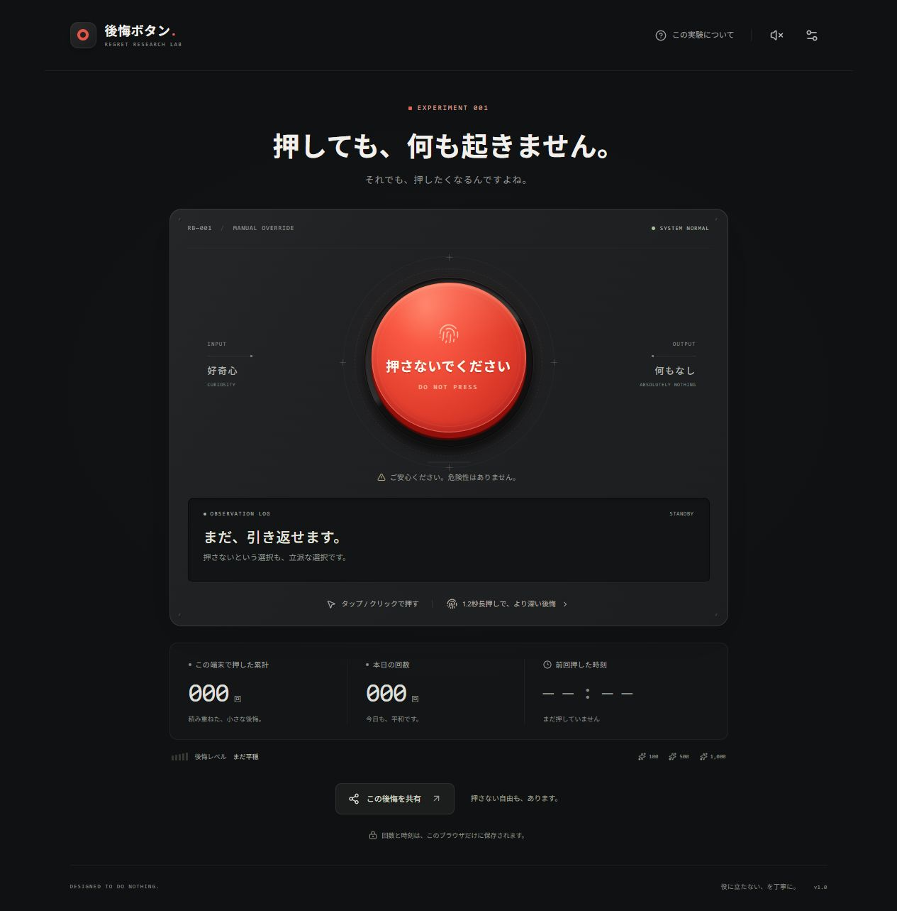
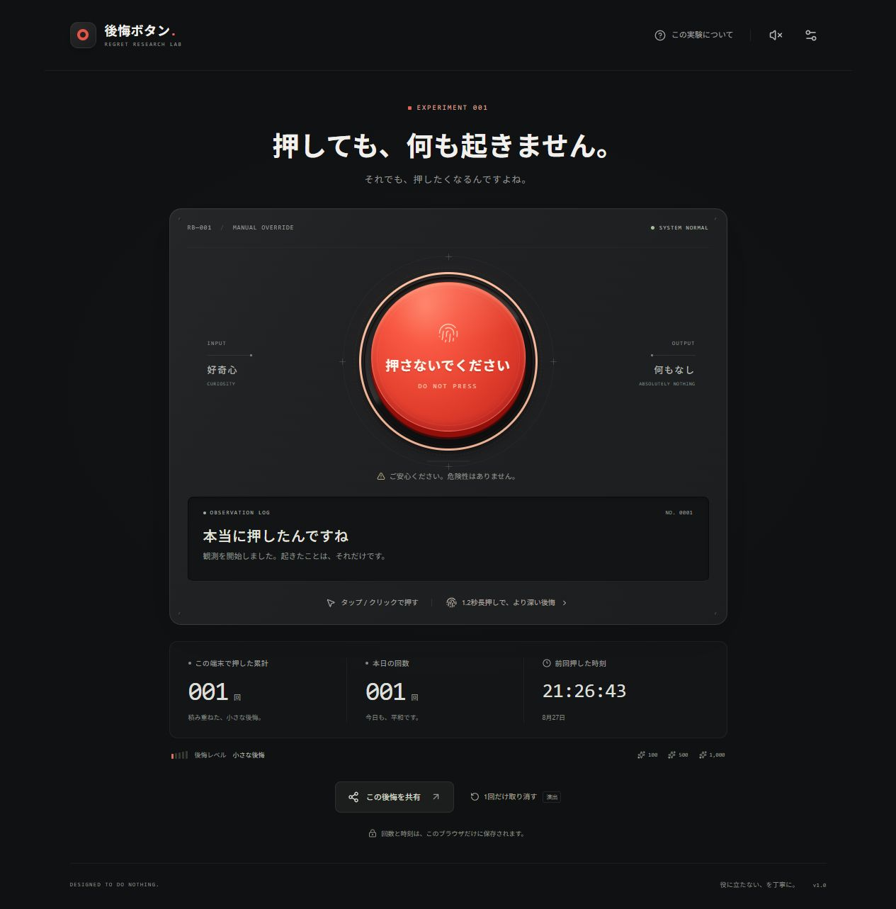
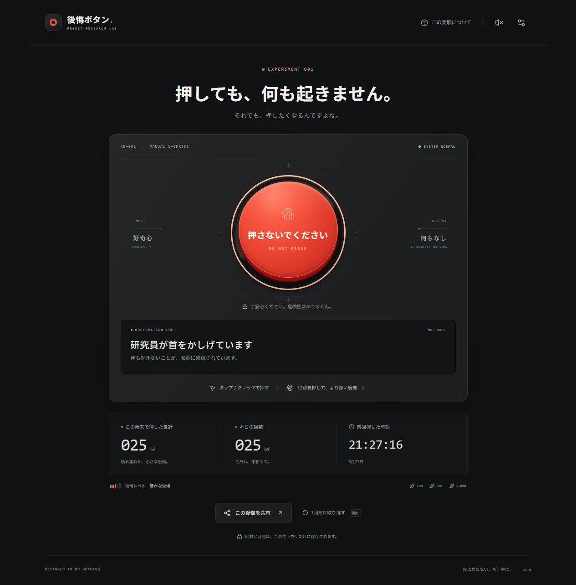
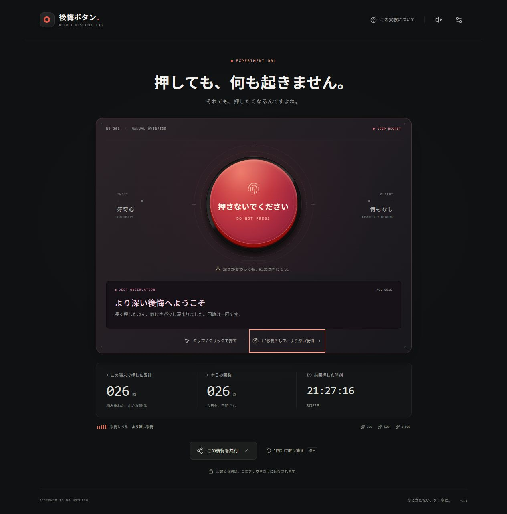
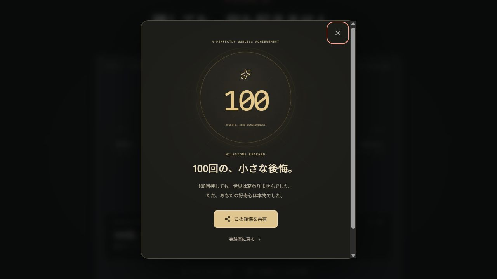

# 後悔ボタン

**押しても、何も起きません。それでも、押したくなるんですよね。**

大きな赤いボタンを押すと、少しだけ後悔する言葉が返ってくるWebアプリです。暗い研究施設を思わせる質感と、静かな動き、控えめな電子音で「役に立たない」を丁寧に作りました。

[アプリを開く](https://regret-button.vercel.app) · [GitHub](https://github.com/shunsoco-stack/regret-button)

## できること

- 回数に合わせて変わるメッセージ。「本当に押したんですね」から、何も起きない研究が続きます。
- このブラウザでの累計、本日の回数、前回押した時刻を表示・保存。
- 1.2秒の長押しで「より深い後悔」。100・500・1,000回には記念演出。
- Web Audio APIによる自作の電子音、対応環境での短い振動。音は初期状態でオフ。
- 共有、設定、本当のリセット、PWAのホーム画面追加とオフライン対応。
- モバイル向けレイアウト、ダークな配色、キーボード操作、Reduced Motion対応。

課金・広告・勝手な外部移動はありません。位置情報、連絡先、カメラ、マイクなどの個人情報に関わる権限も要求しません。物騒なメッセージはすべて演出です。

## 遊び方

| 操作 | 結果 |
| --- | --- |
| 赤いボタンをタップ・クリック | 1回だけ加算し、メッセージを表示 |
| 赤いボタンを1.2秒長押し | 「より深い後悔」を表示。長く押し続けても1回 |
| ボタンにフォーカスし、SpaceまたはEnter | 通常押下。キーを1.2秒保持すると長押しと同じ体験 |
| ボタン下の長押し案内、または設定の代替ボタン | 長押しせずに「より深い後悔」を1回体験 |
| 「1回だけ取り消す」 | 「取り消せません」と表示する演出。回数は変わりません |
| 設定 →「記録をリセットする」→ 確認 | 回数・深い後悔の回数・前回時刻・取り消しの使用状態を消去。設定は保持 |
| 「この後悔を共有」 | OSの共有画面、クリップボードへのコピー、手動コピーの順に対応 |

取り消しの演出は、リセットするまで一度だけ表示できます。本当のリセット後に記録を復元する機能はありません。

### 音・動き・アクセシビリティ

音は上部のサウンドボタン、または設定から有効にできます。録音された効果音は使わず、ユーザーの操作後にWeb Audio APIで生成します。音声・振動APIが利用できない環境では、無音・無振動のまま遊べます。

「ボタンが少し逃げる」は設定で停止できます。OSのReduced Motion、またはアプリの「動きを減らす」が有効な場合も移動演出を停止します。見た目の動きに関わらず、押せる領域を動かして操作を妨げることはありません。

初期設定は、音オフ・振動オン・逃げる演出オン・アプリ内の「動きを減らす」オフ・利用状況の送信オンです。OSのReduced Motionはアプリ内設定より優先されます。

## 保存とプライバシー

保存先は、このブラウザのlocalStorage内の **`regret-button:v1`** だけです。累計、本日の集計日と回数、前回時刻、深い後悔の回数、取り消しの使用状態、各設定を保存します。

- 「本日」は端末のローカル日付で判定します。端末の時計やタイムゾーンの変更は集計に影響します。
- 同じブラウザ・同じオリジンの別タブには変更を反映します。端末間・ブラウザ間の同期やアカウント機能はありません。
- 同時に複数タブで押す場合の完全な排他制御は行いません。競合で一部の更新が上書きされる可能性があります。
- ブラウザデータの消去やプライベートモード等で記録を失うことがあります。保存できない場合は警告を表示し、その画面内では操作を継続します。
- 設定のリセットは専用キーだけを更新します。他アプリのlocalStorageや設定は消しません。
- 自分で共有した場合だけ、回数を含む文章とURLが選んだ共有先、またはクリップボードに渡ります。

### Vercel Analytics

ページ表示と、次の操作イベントを計測する実装です。**任意の累計回数、前回時刻、端末内の記録、アプリ独自の識別子はイベントに含めません。** URLのクエリ文字列とフラグメントも送信前に除外します。

| イベント | 内容 | 追加情報 |
| --- | --- | --- |
| `button_press` | 通常押下 | なし |
| `long_press` | 長押し、または代替操作での深い後悔 | なし |
| `share` | OS共有完了、コピー成功、または手動コピー画面の「完了」 | 共有方式のみ |
| `milestone` | 節目への到達 | 固定値の100・500・1,000のいずれか |

設定の「匿名の利用状況を送る」をオフにすると送信を停止します。ブラウザのDo Not Trackが有効な場合もイベントを送信しません。計測の失敗でボタン操作を止めることはありません。ページ表示や計測には通信があるため、アプリ全体が通信しないという意味ではありません。

公開プロジェクトのWeb Analyticsは有効化済みです。**現在のHobbyプランではカスタムイベントの集計・閲覧に制限があり、ProまたはEnterpriseが必要です。** 4種類のイベント送信処理とオプトアウトを実装・テスト済みですが、カスタムイベント集計APIによる受信確認はプラン制限のため未完了です。有料プランへの変更は行っていません。詳細は[検証記録](docs/verification.md)を参照してください。

## ローカルで動かす

Node.js 24.xとnpmを使用します。**アプリの起動にAPIキーや環境変数は不要です。**

```bash
git clone https://github.com/shunsoco-stack/regret-button
cd regret-button
npm ci
npm run dev
```

ブラウザで `http://localhost:3000` を開きます。

### 検証コマンド

```bash
npm run lint
npm run typecheck
npm test
npm run build
npm run secret-scan
```

本番ビルドをローカルで確認する場合は、ビルド後に `npm start` を実行します。アイコン・favicon・OG画像の再生成は `npm run assets` です。

GitHub Actionsにも検証用のworkflowを用意しています。Secret Scanの対象と限界、CIの方針は[セキュリティ文書](docs/security.md)を参照してください。

## PWA・オフライン利用

対応ブラウザでは「ホーム画面に追加」や「インストール」からアプリとして起動できます。操作方法やインストール可否はブラウザとOSによって異なります。

オフライン利用には、最初にオンラインで開き、Service Workerと必要な画面・静的ファイルのキャッシュ準備が完了している必要があります。Service Workerは本番ビルドのHTTPS環境、またはローカル確認用のlocalhostでのみ登録し、`npm run dev` では登録しません。

ブラウザが保存領域を消去した場合は再度オンライン表示が必要です。共有先への送信やAnalyticsの受信はオフラインでは保証しません。PWAを追加しても、通知・位置情報・バックグラウンド同期を有効にする処理はありません。

## 技術と構成

Next.js **16.3.3**（App Router） / React **19.2.8** / TypeScript / Tailwind CSS **4** / Vercel Analytics **2.0.1** / Vitest

```text
src/app/                 ページ、メタデータ、manifest、スタイル
src/components/          実験画面、設定、共有、Analytics、PWA登録
src/hooks/               押下・長押し、逃げる動き、Reduced Motion
src/lib/regret.ts        集計・正規化・メッセージ・節目の純粋な処理
src/lib/store.ts         useSyncExternalStoreとlocalStorage同期
src/lib/feedback.ts      Web Audioと振動
public/                  アイコン、favicon、OG画像、Service Worker
public/screenshots/      公開後の画面画像
tests/                   集計、保存、操作、音・振動、Service Workerのテスト
scripts/                 素材生成とSecret Scan
docs/                    検証記録、セキュリティ、ポートフォリオ用文章
.github/workflows/       CI
```

独立したNext.jsプロジェクトとしてVercelへ公開できます。フォークして別URLで公開する場合は、`src/lib/site.ts` の `SITE_URL` を変更してからビルドしてください。

## スクリーンショット

2026-08-27に公開URLから撮影しました。画像は加工していません。長押しモードの画像は、同じモードに入るアクセシビリティ用の代替操作で撮影しています。

### 1. 初期画面



### 2. 1回押した状態



### 3. 連打後の状態



### 4. 長押しモード



### 5. 100回記念演出



## 関連ドキュメント

- [検証結果と確認範囲](docs/verification.md)
- [セキュリティ・データの扱い](docs/security.md)
- [ポートフォリオ・Tsukutta・YOUTRUST用の公開文](docs/publish-copy.md)
